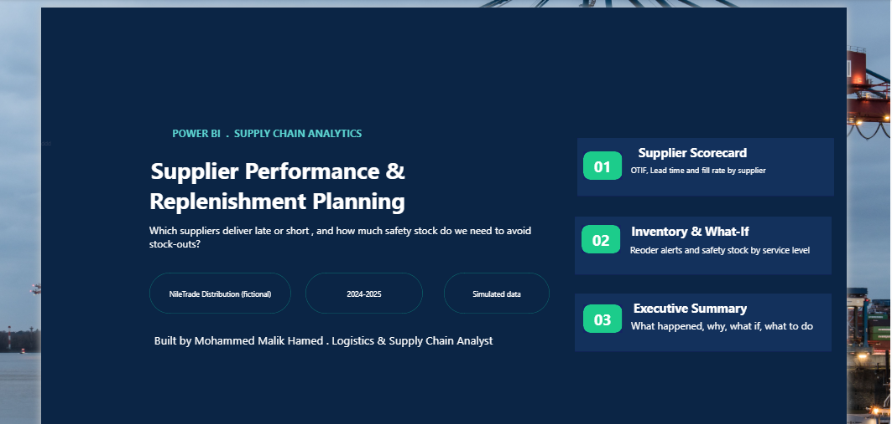
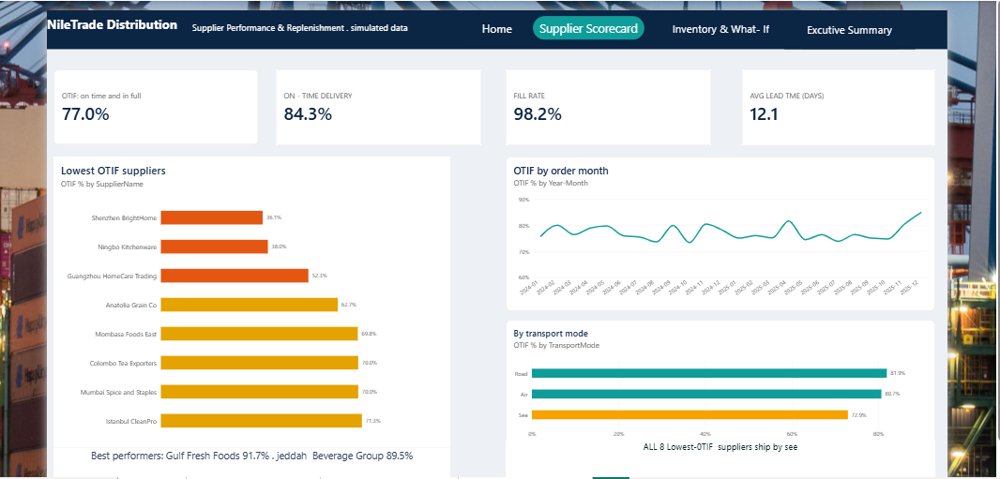
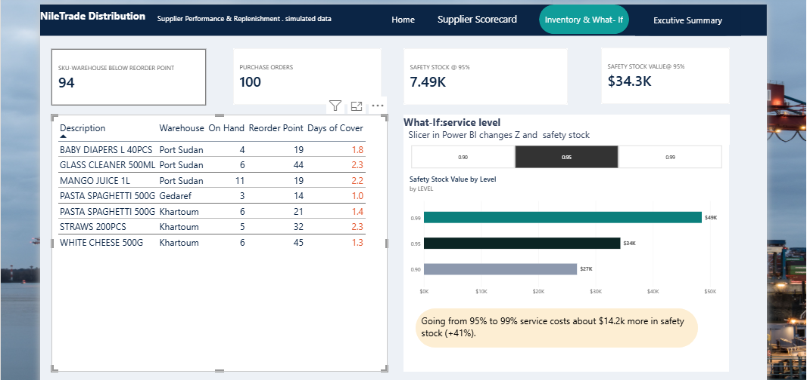
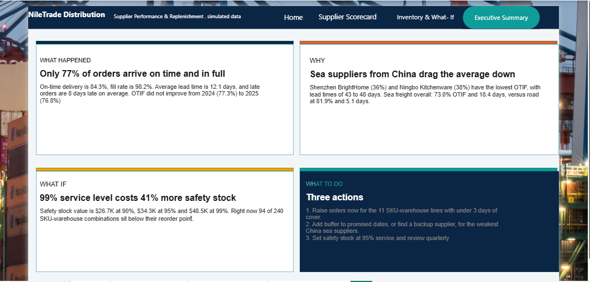

# NileTrade Distribution: Supplier Performance & Replenishment Planning

A Power BI project that answers two questions for a fictional Sudan-based distributor:
**which suppliers deliver late or short, and how much safety stock is needed to avoid stock-outs?**

> **Note:** NileTrade Distribution is a fictional company and all data is simulated (2024-2025, USD). It was generated for this portfolio project.





## Key findings

| Metric | Value |
|---|---|
| OTIF (on time and in full) | **77.0%** |
| On-time delivery | 84.3% |
| Fill rate | 98.2% |
| Average lead time | 12.1 days |
| Sea freight OTIF / lead time | 73.0% / 18.4 days |
| Road freight OTIF / lead time | 81.9% / 5.1 days |
| SKU-warehouse lines below reorder point | 94 of 240 |
| Safety stock value at 90 / 95 / 99% service | $26.7K / $34.3K / $48.5K |

- OTIF did not improve between 2024 (77.3%) and 2025 (76.8%).
- The weakest suppliers are Chinese sea suppliers (Shenzhen BrightHome 36.1%, Ningbo Kitchenware 38.3%) with 43 to 48 day lead times.
- Moving from 95% to 99% service level costs about $14.2K (+41%) more in safety stock.

## Report pages

1. **Home**: overview and navigation
2. **Supplier Scorecard**: OTIF, on-time, fill rate and lead time by supplier, month and transport mode
3. **Inventory & What-If**: reorder alerts and safety stock by service level
4. **Executive Summary**: what happened, why, what if, what to do

### Supplier Scorecard





### Inventory & What-If





### Executive Summary





## What I did

- **Power Query**: trimmed text, fixed casing, replaced nulls, removed duplicate PO rows, set data types.
- **Data model**: star schema (Suppliers, SKUs, Warehouses, DateTable) with PurchaseOrders, Demand and Inventory facts.
- **DAX**: OTIF %, On-Time %, Fill Rate %, Avg Lead Time, Safety Stock, Reorder Point, Days of Cover, and a What-If service level parameter.

```DAX
Safety Stock = [Z Score] * [Demand Std Dev] * SQRT([Lead Time (weeks)])
Reorder Point = [Avg Weekly Demand] * [Lead Time (weeks)] + [Safety Stock]
```

## Files

- `NileTrade_Supply_Chain_Data.pbix`: the Power BI report
- `NileTrade_Supply_Chain_Data.xlsx`: the simulated dataset
- `images/`: report screenshots

## Author

**Mohammed Malik Hamed**, Logistics & Supply Chain Analyst
